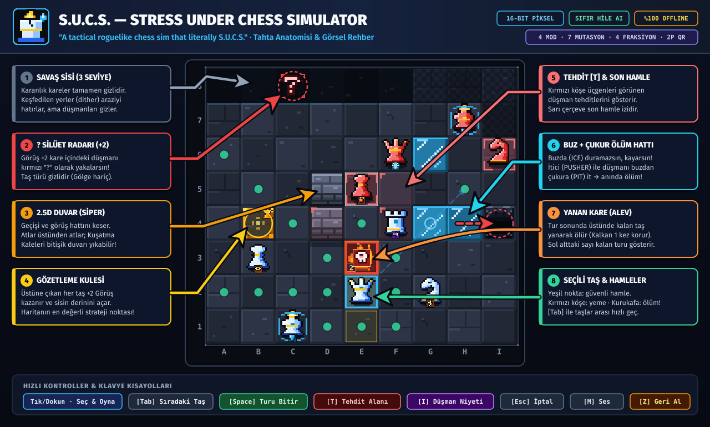
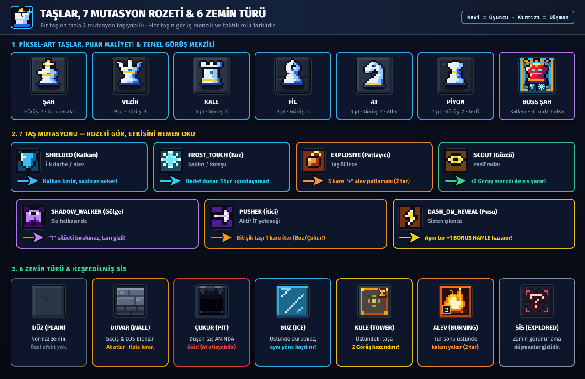
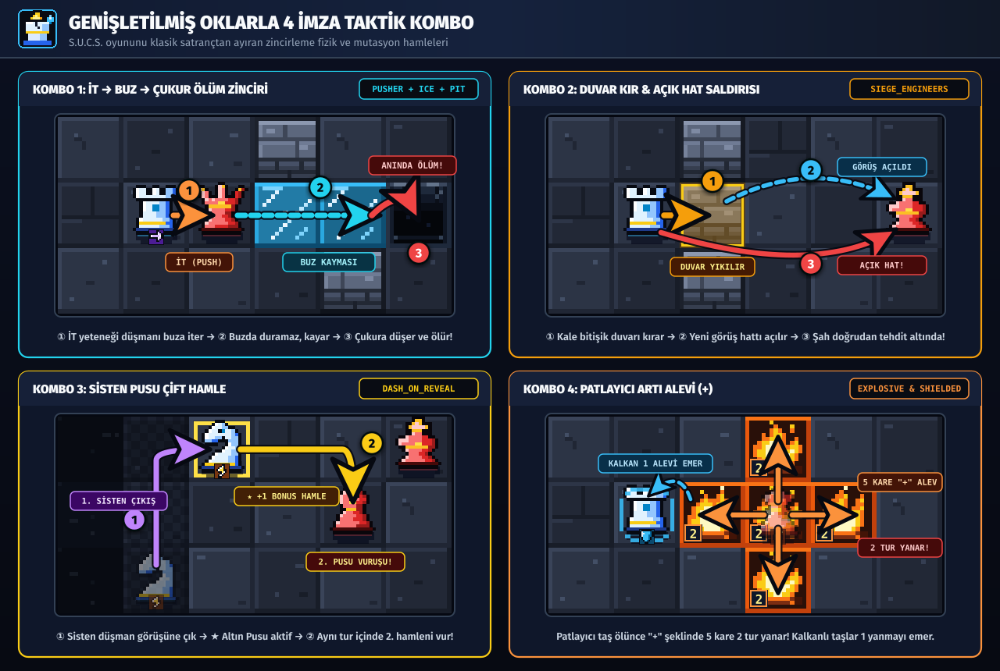
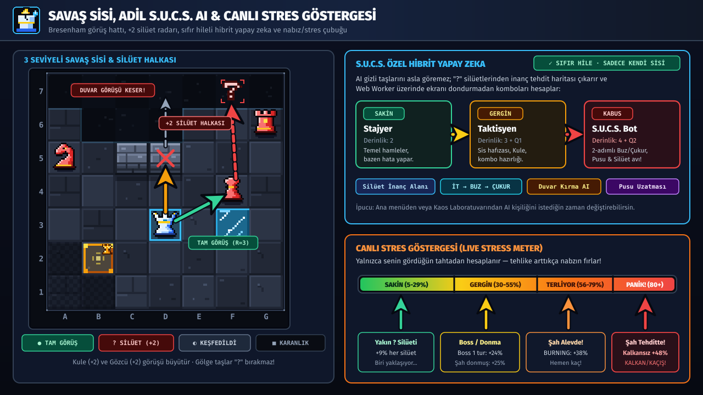
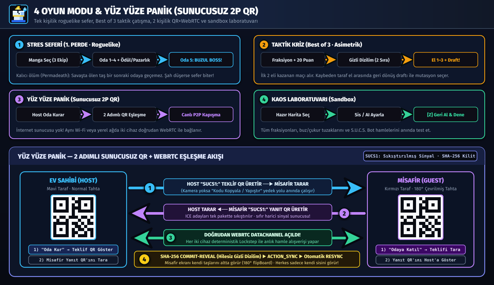

# 📖 S.U.C.S. — Basit & Resimli Oyun Rehberi

> **Stress Under Chess Simulator (S.U.C.S.)**
> *"A tactical roguelike chess sim that literally S.U.C.S."*
>
> Sisin altında, buzda kayarken ve Şah'ın alevlerin ortasındayken hayatta kalmaya hazır mısın? Bu rehber seni **3 dakikada** tüm kurallara, kombolara ve modlara hakim hale getirir.

---

## 🧭 1. Tahta Anatomisi (Tek Bakışta Her Şey)

### 🎯 Oyunun Amacı
Rakibin **Şah** taşını yok etmek! Klasik satrançtaki gibi sadece yiyerek değil, şu **3 yoldan herhangi biriyle** kazanabilirsin:
1. **Doğrudan Yemek:** Rakip Şah'a saldırıp tahtadan silmek.
2. **Çukura İtmek / Kaydırmak (`PIT`):** `PUSHER (İT)` veya `ICE` kaymasıyla Şah'ı çukura düşürmek *(anında zafer!)*.
3. **Yakmak (`BURNING`):** Şah'ın tur sonunda yanan karede (kalkansız) kalmasını sağlamak.

> ⚠️ **Dikkat:** Aynı 3 tehlike senin Şah'ın için de geçerlidir!

### ⚡ 4 Adımda Bir Tur Nasıl Oynanır?
1. **Taşını Seç:** Kendi mavi taşlarından birine tıkla/dokun (veya `[Tab]` ile sıradaki taşa geç).
2. **Önizlemeyi Oku:**
   - 🟢 **Yeşil nokta:** Güvenli normal hamle.
   - 🔴 **Kırmızı köşe çerçevesi:** Düşmanı yeme hamlesi.
   - 🔵 **Mavi halka / kesikli çizgi:** Buzda kayma (`ICE`) rotası.
   - 💀 **Kurukafa uyarısı:** Çukura düşme veya ateşte bitirme *(tehlikeli hamle!)*.
3. **Hamle Yap veya Aktif Yetenek Kullan:** Taşı hedef kareye gönder; varsa sol/sağ panelden **`İT (PUSH)`** ya da **`DUVAR KIR (BREAK_WALL)`** yeteneğini seçip hedef kareye tıkla.
4. **Sıra Rakibe Geçer:** İstersen hamle yapmadan `[Space]` ile turu pas geçebilirsin. *(Not: `DASH_ON_REVEAL` tetiklenirse aynı tur **2. kez** oynarsın!)*

### ⌨️ Hızlı Kontroller & Kısayollar

| Girdi / Tuş | Ne İşe Yarar? |
| :--- | :--- |
| **Tıkla / Dokun** | Taş seç, kare incele, hamle veya aktif yetenek uygula |
| **`Tab`** | Hareket edebilen bir sonraki taşı hızlıca seç |
| **`Space`** | Turu bitir *(2P'de hamle sonrası Sıradaki geçişi · maç sonunda sonraki ekran)* |
| **`Enter`** | Yüz Yüze 2P modunda **`Sıradaki ↻`** tuşunu tetikler ve tahtayı 180° çevirir |
| **`T`** | **Tehdit Alanını** aç/kapat *(görünen düşmanların vurabileceği kareler)* |
| **`I`** | **Düşman Niyet Oklarını** aç/kapat *(Sefer modunda)* |
| **`Esc`** | Aktif seçimi veya yetenek modunu iptal et |
| **`M`** | 16-bit Web Audio ses efektlerini aç/kapat |
| **`Z`** | Son hamleyi geri al *(yalnızca **Kaos Laboratuvarı** modunda)* |

---

## ♟️ 2. Taşlar, 7 Mutasyon Rozeti & 6 Zemin Türü

### 🧩 Taşlar & Görüş Menzilleri
Taşlar klasik satranç kurallarıyla hareket eder, ancak ek olarak **savaş sisini açma yarıçapına** sahiptirler:

| Taş | Taktik Kriz Maliyeti | Temel Görüş | Özel Not |
| :--- | :---: | :---: | :--- |
| **Şah** | Zorunlu | `3` kare | Düşerse maç biter! |
| **Vezir** | `9 pt` | `3` kare | Her yöne en güçlü saldırı taşı |
| **Kale** | `5 pt` | `3` kare | *Kuşatma Mühendisleri* ile bitişik duvarları yıkabilir |
| **Fil** | `3 pt` | `3` kare | Uzun çapraz kontrol ve geniş görüş |
| **At** | `3 pt` | `2` kare | **Duvar ve çukurlardan atlar**, buzda kaymaz! |
| **Piyon** | `1 pt` *(Gözcü: `2 pt`)* | `2` kare | Rakibin son sırasına ulaşınca **Vezir** olur |

### 🧬 7 Taş Mutasyonu (Bir Taşta En Fazla 3 Adet)

| Rozet | Mutasyon | Ne Yapar? |
| :--- | :--- | :--- |
| 🛡️ | **`SHIELDED` (Kalkan)** | İlk saldırıyı veya 1 yanma hasarını emer; saldıran taşı geri püskürtür. |
| ❄️ | **`FROST_TOUCH` (Buz Dokunuşu)** | Temas ettiği / vurduğu düşmanı dondurur (donan taş kıpırdayamaz). |
| 💥 | **`EXPLOSIVE` (Patlayıcı)** | Öldüğünde kendi karesi + 4 ortogonal komşusunda (**`+` şeklinde 5 kare**) 2 turluk alev patlatır. |
| 👁️ | **`SCOUT` (Gözcü)** | Taşın görüş menzilini **+2 kare** artırır; sis avcılarının vazgeçilmezidir. |
| 👤 | **`SHADOW_WALKER` (Gölge)** | `+2` silüet halkasında kırmızı `?` işareti bırakmaz; yalnızca tam görüşte fark edilir. |
| 🤜 | **`PUSHER` (İtici)** | Aktif **`İT`** yeteneği verir: Bitişik bir taşı 1 kare öteye iter (buz/çukur kombolarının kralı!). |
| ⚡ | **`DASH_ON_REVEAL` (Pusu)** | Rakibin sisinden çıkıp görünür olduğu tur otomatik **+1 Bonus Hamle** (altın çerçeve) kazanır! |

### 🗺️ 6 Zemin Türü
- **Düz (`PLAIN`):** Standart güvenli taş zemin.
- **Duvar (`WALL`):** Yürüyüşü ve görüş hattını keser. **Atlar üstünden atlar**, *Kuşatma Mühendisleri* Kaleleri yıkabilir.
- **Çukur (`PIT`):** Düşen taş **anında ölür** (Atlar üstünden atlayabilir).
- **Buz (`ICE`):** Üstüne basan (veya itilen) taş duramaz, hareket yönünde engele/düz zemine/çukura kadar **kayar**! *(Atlar ve Buzul Muhafızları kaymaz.)*
- **Gözetleme Kulesi (`WATCHTOWER`):** Üstünde duran taşa **+2 Görüş Menzili** kazandırır.
- **Yanan Kare (`BURNING`):** Tur sonunda üstünde kalan taş yanarak ölür (Kalkan varsa sadece kalkanı kırılır). Sol alttaki sayı kaç tur daha yanacağını gösterir.

### 🛡️ 4 Fraksiyon Pasifi

| Fraksiyon | Pasif Güç | En İyi Kullanım |
| :--- | :--- | :--- |
| ❄️ **Buzul Muhafızları** | Tüm taşlar `ICE` üzerinde kaymadan tam hedef karesinde durur. | Buzlu haritalarda güvenle pozisyon al, rakipleri buza çek! |
| 💀 **Nekromanserler** | Şah dışındaki ölen her taşın karesinde 2 tur sonra **1 İskelet Piyon** doğar *(kare boşsa)*. | Düşmanın doğuş karesinin üstüne basarsan iskelet doğuşunu engelleyebilirsin! |
| 🧱 **Kuşatma Mühendisleri** | Tüm Kaleler bitişik duvarları yıkan **`DUVAR KIR (BREAK_WALL)`** yeteneği kazanır. | Güvenli sandığı siperin arkasındaki rakip Şah'a aniden koridor aç! |
| ⚡ **Akıncılar** | Tüm Atlar otomatik **`DASH_ON_REVEAL` (Pusu)** kazanır. | Sisten fırlayıp aynı turda hem saldır hem kaç (veya iki kere sıçra)! |

---

## 💥 3. Genişletilmiş Oklarla 4 İmza Taktik Kombo

1. **Kombo 1 — `İT → BUZ → ÇUKUR` Ölüm Zinciri:**
   `PUSHER` rozetli taşınla düşmanın yanına gel → **`İT`** yeteneğiyle buz (`ICE`) koridoruna doğru it → düşman buzda duramayıp çukura (`PIT`) kayar ve **kalkanı olsa bile** anında yok olur!
2. **Kombo 2 — `DUVAR KIR` ile Sürpriz Açık Hat:**
   *Kuşatma Mühendisleri* Kaleni duvarın yanına getir → **`DUVAR KIR`** ile siperi parçala → aynı anda hem yeni görüş hattı (`LOS`) açılır hem de Kale tüm koridoru tehdit eder!
3. **Kombo 3 — Sisten Çıkış & Altın Pusu (`DASH_ON_REVEAL`):**
   Rakibin görüşü dışında bekle → 1. hamlede düşman görüşüne gir → taşın **altın çerçeveyle** parlayarak **+1 Bonus Hamle** kazanır → 2. hamlede kritik hedefi vur veya güvenle geri kaç!
4. **Kombo 4 — Patlayıcı Artı Alevi (`EXPLOSIVE`) & Kalkan:**
   `EXPLOSIVE` bir düşmanı yerken dikkat et: ölür ölmez **`+` şeklinde 5 kare** alev alır! O kareden kaçacak hamlen veya `SHIELDED` kalkanın yoksa sen de yanabilirsin.

---

## 🌫️ 4. Savaş Sisi, Sıfır Hile AI & Canlı Stres Göstergesi

### 👁️ Savaş Sisi Nasıl Çalışır?
- **Tam Görüş (`VISIBLE`):** Taşlarının görüş yarıçapı içindeki ve duvar arkasında kalmayan her şey nettir.
- **`+2` Silüet Halkası (`?`):** Görüş sınırının hemen **1–2 kare ötesinde** düşman varsa kırmızı **`?`** radarı yanar! Orada biri olduğunu bilirsin ama taş türünü göremezsin *(yalnızca `SHADOW_WALKER` gizli kalır)*.
- **Keşfedildi (`EXPLORED`):** Daha önce gördüğün kareler piksel dither perdeyle kalır; araziyi görürsün ama düşmanların orada olup olmadığını bilemezsin.
- **Karanlık (`UNEXPLORED`):** Henüz hiç görülmemiş tamamen gizli bölge.

### 🤖 Adil S.U.C.S. Hibrit AI (Sıfır Hile!)
Yapay zeka senin gizli taşlarını **asla görmez**; tıpkı senin gibi kendi sisinden ve `?` silüetlerinden tahmin yürütür. Ana menüden veya Laboratuvardan 3 zorluktan birini seçebilirsin:
- 🟢 **Stajyer (`SAKİN`):** Öğrenme ve ısınma için ideal; temel hamleler yapar.
- 🟡 **Taktisyen (`GERGİN`):** Gözetleme kulelerini tutar, sis hafızası kullanır, fırsatçı kombolar arar.
- 🔴 **S.U.C.S. Bot (`KABUS`):** 2 adımlı `İT → BUZ → ÇUKUR` tuzakları kurar, duvar kırar, Pusu çift hamlelerini ve derin taş değişimlerini hesaplar!

### 💓 Canlı Stres Göstergesi (Stress Meter)
Sağ paneldeki stres çubuğu, yalnızca senin görebildiğin tahtadan anlık tehlikeni ölçer:
- `5–29%` **SAKİN** · `30–55%` **GERGİN** · `56–79%` **TERLİYOR** · `80–100%` **PANİK ATAK!**
- Şah'ın doğrudan tehdit altındaysa (`+48%`), alevdeyse (`+38%`), donmuşsa (`+25%`) veya Boss buz/alev halkası 1 tur sonra patlayacaksa (`+24%`) nabzın anında fırlar!

---

## 🎮 5. Oyun Modları, Boss İpuçları & Yüz Yüze Panik (Aynı Cihazda 2P)

### 🗺️ 1. Stres Seferi (1. Perde — Roguelike)
3 başlangıç mangasından (*Keşif Mangası*, *Kuşatma Birliği*, *Suikastçılar*) birini seçip **5 odayı** aşmaya çalış:
1. **Oda 1 · Orman Sınırı:** İlk ısınma, hafif siperler ve gözetleme kuleleri.
2. **Oda 2 · Buzul Geçidi:** *Buzul Muhafızları* kaymaz; çukurlara kaymamaya dikkat!
3. **Oda 3 · Kemik Ovası:** *Nekromanserler* 2 turda İskelet Piyon diriltir; spawn karelerinin üstüne basıp engelle!
4. **Oda 4 · Kuşatma Duvarı:** *Kuşatma Mühendisleri* duvarları kırıp yeni koridorlar açar.
5. **Oda 5 · BOSS — Buzul Kuşatma Komutanı:** Zırhlı Boss Şah **her 3 düşman turunda** etrafındaki 1 karelik halkaya buz/alev saçar!
   - 💡 **Boss Hayatta Kalma İpucu:** Önce kalkanını ucuz bir taşla (veya uzaktan) kır, sonra Boss halkası `1 tur` uyarısı verdiğinde yakınındaki değerli taşlarını 1 kare geri çek!
- Odalar arasında **ödül** (yeni taş / mutasyon) veya riskli **karanlık pazarlık** seçebilirsin. Unutma: **Kalıcı ölüm (Permadeath)** vardır!

### ⚔️ 2. Taktik Kriz (Best of 3)
- **20 puanlık bütçe** ile kendi asimetrik ordunu ve fraksiyonunu kur.
- İlk 2 sıraya **gizli dizilim** yap; ilk **2 eli** alan galip gelir.
- El kaybeden taraf, bir sonraki el öncesi **geri dönüş draftı** ile ordusuna mutasyon ekler!

### 📱 3. Yüz Yüze Panik (Aynı Cihazda 2P — Dönen Tahta & Sıradaki Tuşu)
Ağ bağlantısı, QR veya kopma derdi olmadan tek telefon ya da bilgisayarda arkadaşınla kararlı **Best-of-3** maç yap:
1. **Gizli Dizilim + Cihazı Devret:** Önce **1. Oyuncu (Mavi)** 20 puanlık ordusunu alt 2 sıraya gizlice yerleştirir. Tamamlanınca gizlilik perdesi açılır ve cihaz **2. Oyuncu (Kırmızı)**'ya verilir; 2. Oyuncu tahtayı otomatik **180° çevrilmiş** olarak görür ve kendi alt 2 sırasını dizer.
2. **Otomatik Dönme Yok:** Savaş sırasında hamleni yaptığında (veya pas geçtiğinde) tahta anında dönmez — hamle animasyonunu, tuzakları ve sonucu kendi yönünden rahatça izlersin.
3. **`Sıradaki ↻` Tuşuyla 180° Geçiş:** Hamlen bitince cihazı rakibine ver. Alt çubukta altın renkte parlayan **`Sıradaki ↻`** tuşuna (veya `[Enter]`/`[Space]`) basıldığında tahta **180° döner** ve savaş sisi yeni oyuncuya geçer! *(Pusu ekstra hamlesi tetiklenirse aynı oyuncu 2. hamlesini bitirene kadar geçiş kilitli kalır.)*
4. **El Arası Geri Dönüş Draftı:** Her el sonunda iki oyuncu da Cihazı Devret perdesiyle sırayla kendi güçlendirme kartını seçer; kaybeden oyuncu Nadir/Epik havuzdan çeker!

### 🧪 4. Kaos Laboratuvarı (Sandbox)
Tüm mekanikleri riske girmeden dene, sis perspektifini (`Oyuncu / Düşman / Her Şeyi Gör`) değiştir, `[Z]` ile hamleleri geri al ve `S.U.C.S. Bot` ile deneyler yap!

---

## 🏆 6. Yeni Başlayanlar İçin 5 Altın İpucu

1. **Gözetleme Kulesini İlk Sen Kap:** Kuleye çıkan tek bir taş bile haritanın yarısını aydınlatır ve pusu yeme riskini sıfıra indirir.
2. **`[T]` Tuşu Hayat Kurtarır:** Hamleni onaylamadan önce `[T]` ile tehdit alanını aç; kırmızı köşe işaretli karelere Şah'ını yanlışlıkla bırakma.
3. **Atlar Arazi Tanımaz:** Duvarlar, çukurlar ve kaygan buz koridorları Atları durduramaz — buzlu haritalarda At en güvenli taşındır.
4. **`?` Silüetine Körlemesine Dalma:** Kırmızı `?` işareti bir Piyon da olabilir, `EXPLOSIVE` ya da `DASH_ON_REVEAL` bekleyen bir Vezir de! Önce Gözcü ile aç.
5. **Kalkanı Kırmak İçin Önce Ucuz Taş Kullan:** `SHIELDED` bir taşa vurduğunda ilk darbe sadece kalkanı kırar ve saldıran taş geri seker; ikinci vuruşu hazırda beklet!

---

⬅️ Proje kurulumu ve teknik mimari için **[README.md](./README.md)** dosyasına göz atabilirsin.
