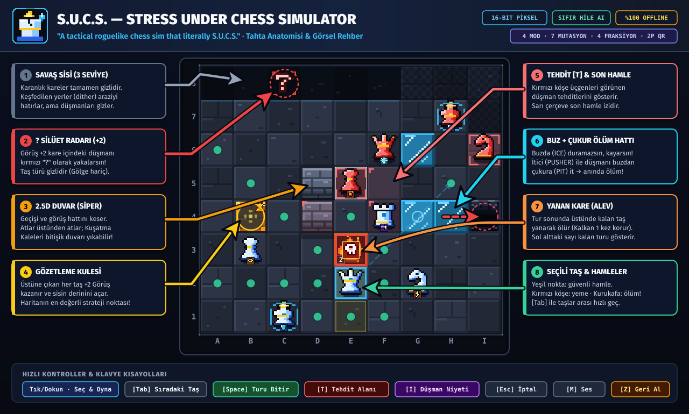
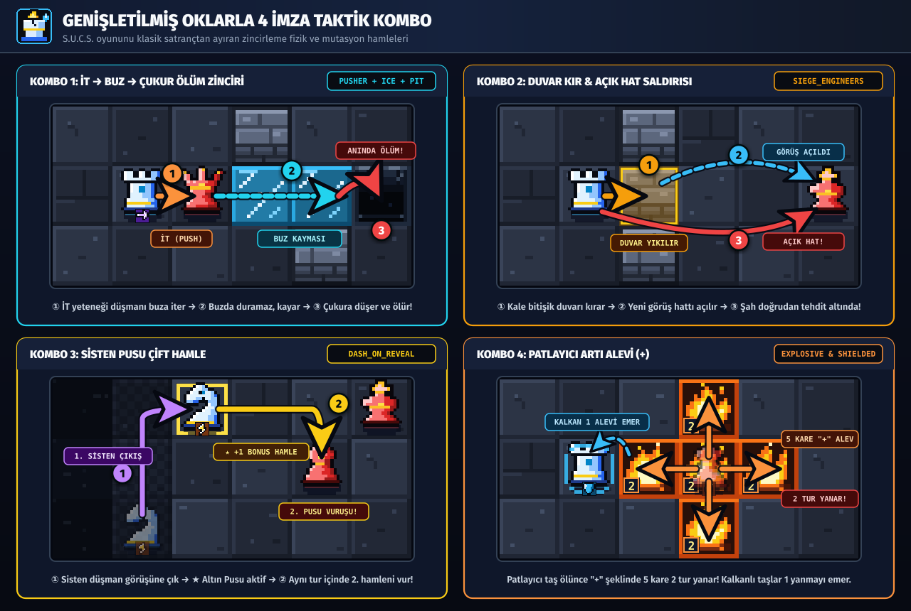
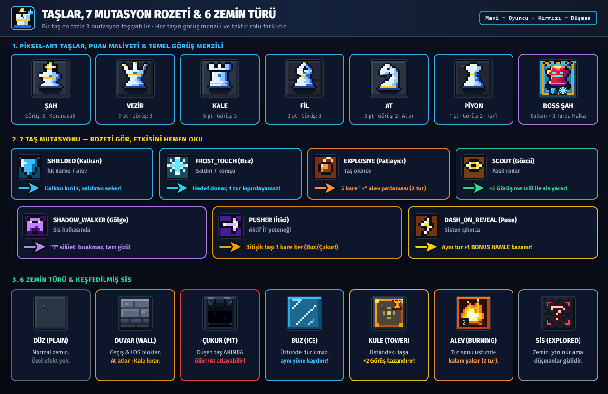
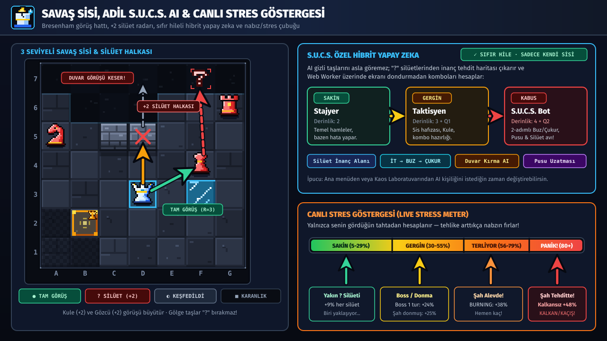
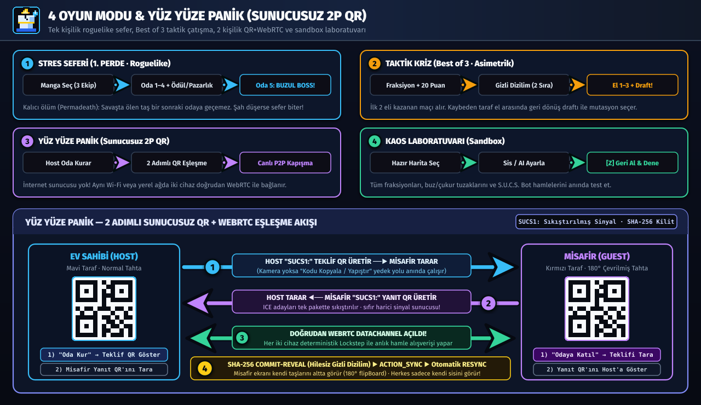

<p align="center">
  
</p>

<h1 align="center">S.U.C.S. — Stress Under Chess Simulator</h1>

<p align="center">
  <strong><em>"A tactical roguelike chess sim that literally S.U.C.S."</em></strong><br/>
  Sisin altında sinir krizi garantili, %100 çevrimdışı, deterministik 16-bit piksel-art taktiksel roguelike &amp; asimetrik satranç.
</p>

<p align="center">
  <code>TypeScript Strict</code> ·
  <code>HTML5 Canvas 2D (24×24 / 32×32 Hibrit Piksel)</code> ·
  <code>OffscreenCanvas Önbellek</code> ·
  <code>Sıfır Hile Hibrit AI (Web Worker)</code> ·
  <code>Aynı Cihazda 2P (180° Dönen Tahta)</code> ·
  <code>152/152 Vitest</code> ·
  <code>AGPL-3.0 + CC BY-NC-ND 4.0</code>
</p>

---

> ### 📖 Yeni misin? Önce Resimli Rehbere Bak!
> Tüm kuralları, taş mutasyonlarını, **genişletilmiş oklarla adım adım komboları**, sis katmanlarını ve aynı cihazda 2P dönen tahta akışını tek bakışta öğrenmek için:
> 👉 **[GUIDEBOOK.md — Basit & Resimli S.U.C.S. Oyun Rehberi](./GUIDEBOOK.md)**

---



## ✨ Öne Çıkan Özellikler

### 🌫️ 1. Simetrik 3 Seviyeli Savaş Sisi, Miasma LOS & Halüsinasyonlar
- `UNEXPLORED` (tamamen karanlık), `EXPLORED` (2×2 piksel dither arazi hafızası) ve `VISIBLE` (Bresenham görüş hattı — `WALL` ve zehirli **`MIASMA`** gazı arkasındaki görüşü simetrik keser!).
- Görüş sınırının `+2` kare ötesindeki düşmanlar kırmızı **`?` silüeti** olarak radara düşer (`SHADOW_WALKER` hariç).
- Yüksek stres (`%75+` `PANIC`) altında dış sis halkasında **halüsinasyon `?` hayaletleri** belirir; yalnızca oyuncunun görsel katmanında yaşar, tıklanınca dağılır ve yapay zeka bundan hile yapamaz.
- Gözetleme kuleleri (`WATCHTOWER`) ve Gözcü (`SCOUT`) rozeti görüş menzilini `+2` kare genişletir.

### 🧪 2. Zindan Kimyası, Tuzaklar, 7 Mutasyon & 4 Fraksiyon
- **Zeminler:** `PLAIN`, 2.5D gölgeli `WALL`, anında öldüren `PIT`, atalet kayması yapan `ICE`, `+2` görüşlü `WATCHTOWER`, 3 kare animasyonlu `BURNING` ve tek geçişte/patlamada `PIT`e çöken **`CRACKED`** kırılgan zemin.
- **Zindan Gazı & Mekanik Tuzaklar:**
  - `MIASMA`: Kayıcıların menzilini kısaltır, `PAWN`/`KING` girişinde `frozenTurns = 1` felci uygular, 2 tur sonu boğar; alev (`BURNING`), alevli ok veya `EXPLOSIVE` patlamasıyla **4-yönlü zincirleme gaz patlaması (`GAS_CHAIN_DETONATED`)** yaratır (`PIT` üstünden köprü kurabilir).
  - **Kablolu Tuzaklar (`PRESSURE_PLATE → ARROW_EMITTER`):** Zemin üzerindeki bakır hatla bağlı baskı plakası, buz kayması veya itme sonucu da tetiklenerek duvar ok atıcısını ateşler (alevli oklar yol üstündeki `MIASMA` ceplerini patlatır).
  - **Ritimli Kazıklar (`SPIKES`):** `0` İnmiş → `1` Sarı Telgraf → `2` Kalkmış ölümcül kazık döngüsü (`PUSHER` itme kombolarıyla uyumlu).
- **7 Mutasyon:** `SHIELDED`, `FROST_TOUCH`, `EXPLOSIVE`, `SCOUT`, `SHADOW_WALKER`, `PUSHER` (aktif `İT`), `DASH_ON_REVEAL` (sisten çıkınca altın +1 bonus hamle).
- **4 Fraksiyon:** *Buzul Muhafızları*, *Nekromanserler*, *Kuşatma Mühendisleri*, *Akıncılar*.



### 🕯️ 3. Taş Psikolojisi, Ocaklı, Meczup, Gulyabani & Çift Tonlu Anlatı
- **Dayanıklılık (`Composure` 3→2→1→0):** Kalkan kırılması, yanma, Miasma maruziyeti ve yakın (`Chebyshev <= 2`) dost ölümünden düşer (`KING` ve `CHIMERA` muaf):
  - `Composure = 1`: Taşta 1px titreme, **45° Kavisli Stres Yalpalaması (`Stress Drift`)** ve tehlikeli karelerde **İtaatsizlik (`Disobedience`)** ihtimali doğar.
  - `Composure = 0`: Sinir krizi (`PIECE_BREAKDOWN`) — 1 tur donar, sonraki tur `1` ile toparlanır.
- **3 Yeni V3 Taşı (Anadolu Folkloru Uyarlaması):**
  - **Ocaklı (`SAINT_FAITH` — 6 Puan):** 2× Şah hareketi; 5×5 dostlara moral & nazar şarjı. **3 tam turda** hedefe `SHIELDED` + **7×7 alanda dost debuff arınması ve 2 tur düşman susturma (`AGIZ_BAGLAMA`)** patlatır.
  - **Meczup (`SAINT_MADNESS` — 6 Puan):** 2× Şah hareketi; 5×5 dostlara `+1` hareket hızı (`FRENZY_HASTE`) ve kalkan delen vuruş (`FRENZY_POWER`). **3 turda Kanlı Cinnet (`CINNET`)** verir (rakip yiyince `+1` bonus hamle + bitişik taşı itme).
  - **Gulyabani (`CHIMERA` — 10 Puan):** 3× Şah hareketi; **Efsun Tutmaz** (donma, Miasma, susturma ve psikoloji çöküşüne tamamen bağışık) + **2 yuvalı FIFO kılık çalma evrimi** (2× 3×3px DNA yuvası, traitsiz piyonlarda yuva yakmaz).
- **Çift Tonlu Terminal Anlatısı (`src/data/narrative.ts`):** Üst bardan **`Dil: Efendi` / `Dil: Filtresiz`** geçişiyle Büyükusta-OS ve tüm taşların %100 deterministik replikleri, anti-spam öncelik seçicisi ve prosedürel 16-bit Web Audio efektleri (`synthSfx.ts`).

### 🧠 4. S.U.C.S. Özel Hibrit AI (`src/ai/sucsAi.ts`) & Canlı Stres Göstergesi
- **%100 Adil (Sıfır Hile):** Yapay zeka yalnızca kendi `VisibleState` ve `AiMemory` verisini görür; rakibin sis altındaki taşlarına ve halüsinasyonlara asla erişmez.
- **3 Zorluk / Stres Kişiliği:**
  - 🟢 **Stajyer (`CALM`)** — Derinlik 2, öğrenme dostu.
  - 🟡 **Taktisyen (`TENSE`)** — Derinlik 3 + Quiescence 1, sis hafızası, kule kontrolü ve kombo farkındalığı.
  - 🔴 **S.U.C.S. Bot (`PANIC`)** — Derinlik 4 + Quiescence 2, `?` silüet inanç tehdit alanı (Belief State), `PUSHER → ICE → PIT/SPIKES`, `MIASMA` gaz zinciri, `PRESSURE_PLATE` tetikleme, `SAINT_FAITH` ulti zamanlaması, `BREAK_WALL` koridor açma ve çoklu-form Gulyabani için **14-hamle dallanma koruması**.
- **Akıcı Performans:** Paketlenmiş **Web Worker** (`src/ai/sucsAiWorker.ts`) üzerinde çalışır, arayüzü asla dondurmaz.
- **Canlı Stres Göstergesi:** Yalnızca oyuncunun görebildiği tehditlerden (alev, kazık telgrafı, zehirli sis, düşman tehdidi) anlık nabız hesaplar (`SAKİN → GERGİN → TERLİYOR → PANİK ATAK!`).

### 🎨 5. 24×24 Taş + 32×32 Kare Hibrit Piksel Motoru (`src/render/spriteCache.ts`)
- **Doğal 1× `OffscreenCanvas` Önbelleği:** Tüm zeminler (`32×32`), taşlar (`24×24`, alt 6px Composure/rozet şeridi hizalı), rozetler (`7×7` — *Nazar*, *Kalkan*, *Ağız Bağlama*, *Cinnet* vb.), 3 karelik alevler ve 4 karelik Miasma tek sefer pişirilip ana döngüde `drawImage` ile çizilir.
- **Sıfır-Mixel Ölçekleme:** Tahta kare boyutu `32px` ve tam katlarına (`32`, `64`, `96...`) kilitlenir; Gulyabani DNA kombinasyonları LRU önbelleğinde tutulur, gizli çekirdek odası otomatik `'crt'` paletine geçer.

### 🎮 6. Dört Farklı Oyun Modu
1. **Stres Seferi (Perde 1–3 + Gizli Çekirdek):** 4 başlangıç mangası (*Kült ve Canavar* dahil); **Perde 1** (*Buzul Kuşatması*), **Perde 2** (*Zindan Kimyası* & `KİMYAGER-OS`), **Perde 3** (*Psikoloji & Gulyabani* & `BÜYÜKUSTA-OS v0.94`) ve **Gizli Perde 4 (`0x00_ÇEKİRDEK`)**, kalıcı ölüm (*permadeath*), oda ödülleri ve karanlık pazarlıklar.
2. **Taktik Kriz (Best of 3):** 20 puanlık asimetrik ordu bütçesi (Ocaklı `6`, Meczup `6`, Gulyabani `10` puan dahil), gizli 2 sıra dizilimi ve el arası geri dönüş dengeli mutasyon draftı.
3. **Yüz Yüze Panik (Aynı Cihazda 2P — Dönen Tahta & Sıradaki Tuşu):** Ağ veya kurulum derdi olmadan tek telefon/bilgisayarda Best-of-3 düello. Her iki taraf Cihazı Devret perdesiyle gizli dizilimini ve el-arası draftını yapar; savaş sırasında tahta her hamlede otomatik dönmez, hamle sonrası alt çubuktaki **`Sıradaki ↻`** tuşuna basıldığında `180°` döner (`flipBoard`) ve savaş sisi diğer oyuncuya geçer.
4. **Kaos Laboratuvarı (Sandbox):** *Gaz+Ok*, *Ocaklı 7×7 Susturma / Meczup Cinnet* ve *Gulyabani + 45° Yalpalama* sahneleri dahil hazır test senaryoları, sis perspektifi geçişi, anlık AI testi ve `[Z]` geri alma.

<details>
<summary>📸 Rehberdeki Diğer Görselleri Hemen Önizle (Taşlar, Sis/AI & Mod Özeti)</summary>





</details>

---

## 🚀 Kurulum & Çalıştırma

Node.js 20+ ve npm yüklü herhangi bir ortamda saniyeler içinde çalışır:

```bash
git clone https://github.com/VelliDR/stress-under-chess-sim.git
cd stress-under-chess-sim
npm install
```

| Komut | Açıklama |
| :--- | :--- |
| `npm run dev` | Yerel Vite geliştirme sunucusunu başlatır |
| `npm test` | 19 test dosyasında tüm **152 Vitest** birim ve entegrasyon testini çalıştırır |
| `npm run build` | Çift sıkı TypeScript kontrolü (`tsconfig.json` + `tsconfig.engine.json`) ve üretim derlemesi |
| `npm run preview` | Üretim derlemesini (`dist/`) yerel olarak önizler |

---

## 🧱 Mimari & Proje Yapısı

```text
stress-under-chess-sim/
├── GUIDEBOOK.md             # 📖 Resimli ve genişletilmiş ok işaretli oyuncu rehberi
├── docs/images/             # 🎨 Oyun motorundan üretilmiş 5 yüksek çözünürlüklü görsel diyagram
├── public/favicon.svg       # 👑 16×16 çatlak taçlı terleyen piksel Şah ikonu
├── src/
│   ├── engine/              # 🔒 %100 saf & deterministik kural çekirdeği (sıfır DOM, sıfır Math.random)
│   │   ├── board.ts         # Tahta, yasal hamle, 45° Stress Drift, ICE kayma & harita bağlantısı
│   │   ├── dungeon.ts       # MIASMA zincir patlama, baskı plakası/ok atıcı, CRACKED & SPIKES fiziği
│   │   ├── fog.ts           # Bresenham LOS (WALL + MIASMA engelli), 3 seviyeli sis & +2 silüet radarı
│   │   ├── prng.ts          # Deterministik Mulberry32 PRNG & kanonik V3 computeStateHash
│   │   ├── psychology.ts    # Composure, İtaatsizlik, Azize auraları, Susturma, Cinnet & Kimera evrimi
│   │   ├── reducer.ts       # 9 adımlı birleşik stepGame() + reaktif kuyruk durum makinesi
│   │   ├── traits.ts        # 7 mutasyon, susturma filtresi & PUSH / BREAK_WALL yetenekleri
│   │   └── visibility.ts    # Anti-cheat VisibleState filtresi & PANIC halüsinasyon üreteci
│   ├── ai/                  # 🧠 Adil S.U.C.S. Hibrit AI (V3 tuzak/Gulyabani desteği) + Web Worker
│   ├── render/              # 🎨 24×24 taş + 32×32 kare + 7×7 rozet piksel atlası, OffscreenCanvas SpriteCache, Juice & FX
│   ├── audio/               # 🔊 %100 prosedürel Web Audio API 16-bit ses sentezleyici
│   ├── data/                # 🗺️ Perde 1–3–4 odaları, Boss'lar, çift tonlu narrative.ts, mangalar & ödüller
│   ├── storage/             # 💾 Versiyonlu localStorage kayıt (`sucs_save_v1`, `sucs_ui_prefs_v1`) & eski kayıt geçişi
│   └── ui/                  # 🖥️ Pointer Events arayüzü, Ana Menü, Ordu Kurucu, 2P Dönen Tahta & Kaos Laboratuvarı
└── tests/                   # ✅ 19 Vitest test dosyası (152 test)
```

### 🔒 Temel Mühendislik İlkeleri
- **Saf Deterministik Çekirdek:** `src/engine/` hiçbir tarayıcı API'si veya `Math.random()` çağrısı içermez (`tsconfig.engine.json` ile derleme zamanında zorlanır).
- **%100 Çevrimdışı Öncelikli:** Harici CDN yok; tüm piksel sprite'lar, prosedürel sesler ve `@fontsource/pixelify-sans` (OFL-1.1, tam Türkçe karakter desteği) yerel olarak derlenir.
- **Tek Girdi Modeli:** Yalnızca Pointer Events (`pointerdown` / `pointermove` / `pointerup`) — masaüstü fare ve mobil dokunmatikte kusursuz çalışır.

## 🙏 Açık Kaynak Bileşenler

- **Vite**, **TypeScript**, **Vitest** — Geliştirme, sıkı tip doğrulama ve test altyapısı
- **`@fontsource/pixelify-sans`** *(SIL OFL 1.1)* — Yerel paketlenmiş Türkçe destekli piksel yazı tipi

---

## 📜 Lisans & Telif Hakları

**Copyright © 2026 VelliDR.**

- **Kaynak Kod (`src/`, `tests/`):** **[GNU Affero General Public License v3.0 (AGPL-3.0-only)](./LICENSE)** — Değiştirilen ve web/ağ üzerinden sunulan tüm sürümlerin kaynak kodu AGPL-3.0 altında açıkça paylaşılmalı ve telif bildirimi korunmalıdır.
- **Oyun İçeriği, Piksel Sanat, Anlatı & Marka:** **[CC BY-NC-ND 4.0 & Tüm Hakları Saklıdır (LICENSE-CONTENT.md)](./LICENSE-CONTENT.md)** — Orijinal piksel çizimler, Türkçe çift tonlu replikler, rehber görselleri ve *"S.U.C.S."* / *"Stress Under Chess Simulator"* / *"Büyükusta-OS"* marka hakları yazılı izin olmadan ticari amaçla kullanılamaz veya yeniden markalanamaz.

## 🤝 Topluluk & Standartlar

- [Katkı Rehberi (`CONTRIBUTING.md`)](./CONTRIBUTING.md)
- [Davranış Kuralları (`CODE_OF_CONDUCT.md`)](./CODE_OF_CONDUCT.md)
- [Güvenlik Politikası (`SECURITY.md`)](./SECURITY.md)
- [Erişilebilirlik (`ACCESSIBILITY.md`)](./ACCESSIBILITY.md)
